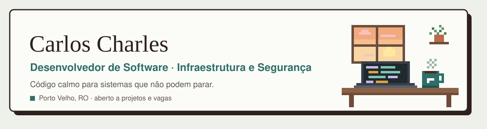

<picture>
  <source media="(prefers-color-scheme: dark)" srcset="./assets/banner-escuro.svg">
  
</picture>

  
  
  

### Oi, eu sou o Carlos ☕

Desenvolvedor de software em Porto Velho (RO), do código ao servidor: back-end em Java, infraestrutura Linux e segurança desde o primeiro deploy. Gosto de entender o problema de quem vai usar o sistema antes de escrever a primeira linha de código.

- Hoje sou **Auxiliar de Programação Sênior na E&L Produções de Software**, evoluindo o **GPI**, ERP de gestão pública usado por prefeituras, nos módulos tributários (ITBI, dívida ativa e integração com a Junta Comercial).
- Participei da **migração do Java 8 para o Java 21** (javax para jakarta) num sistema com vários módulos em EJB, WildFly e GWT.
- Fora do trabalho, construo e mantenho sistemas próprios **em produção**, do banco de dados à infraestrutura: Docker, systemd, Nginx com HTTPS, deploy por script e backup.
- Estou seguindo uma **trilha rumo a DevSecOps** e me preparando para a certificação **AWS Cloud Practitioner**.
- **2º lugar no Béra Hackathon 2025**, a única equipe universitária no pódio.

### O que eu construí

| Projeto | O que faz | Stack |
|---|---|---|
| **S.A.G.E** em produção, com cliente ativo | ERP de pedidos, estoque e gestão para restaurantes. Calcula o pedido de compra a partir da sobra do dia, envia para cada fornecedor pelo WhatsApp e gera relatórios em PDF no sistema ou pelo próprio WhatsApp. | Vue.js 3 · Spring Boot · PostgreSQL · JasperReports · Docker · Nginx |
| **Atendimento com IA** em produção | Plataforma multiempresa de atendimento automático: consulta catálogo, confere estoque e registra pedidos, com LLM rodando em servidor próprio e proteção contra prompt injection. | Node.js · PostgreSQL · Ollama |
| **Agendamento em UBS** Béra Hackathon 2025, 2º lugar | Agendamento de consultas nas unidades básicas de saúde pela mensageria, aceitando mensagens de áudio para facilitar a vida dos idosos. Feito em 48 horas. | Python · Node.js · Next.js · OpenAI API |

> O código do S.A.G.E e do atendimento com IA é privado, porque atende clientes reais. Quer ver funcionando? [Peça uma demonstração](https://wa.me/556992700080?text=Oi%20Carlos%21%20Vi%20seu%20GitHub%20e%20quero%20uma%20demonstra%C3%A7%C3%A3o.).

### Com o que eu trabalho

**Back-end** 

**Front-end** 

**Dados e relatórios** 

**Infra e DevOps** 

**Segurança e IA** 

<b>English version</b>

 

Software developer based in Porto Velho, Brazil, from code to server: Java back end, Linux infrastructure and security from the very first deploy. I like to understand the user's problem before writing the first line of code.

- **Senior Programming Assistant at E&L Produções de Software**, working on GPI, a public management ERP used by city governments, in its tax modules.
- Took part in the **migration from Java 8 to Java 21** (javax to jakarta) in a multi-module system built on EJB, WildFly and GWT.
- Outside work, I build and run my own systems **in production**, from the database to deployment: **S.A.G.E**, a purchasing, inventory and management ERP for restaurants with WhatsApp order automation, and a multi-tenant **AI customer service platform** running a local LLM.
- **2nd place at Béra Hackathon 2025**, the only university team on the podium.
- Currently on a **DevSecOps learning track**, preparing for **AWS Cloud Practitioner**.

Portfolio in English: [carloscharlesdev.cloud/en](https://carloscharlesdev.cloud/en/)

---

Feito em Porto Velho, com bastante café.

